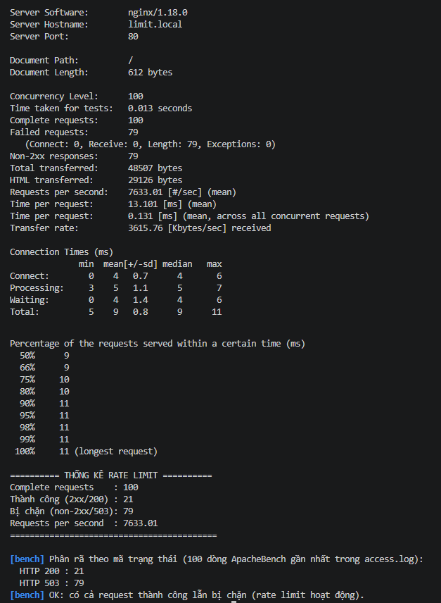
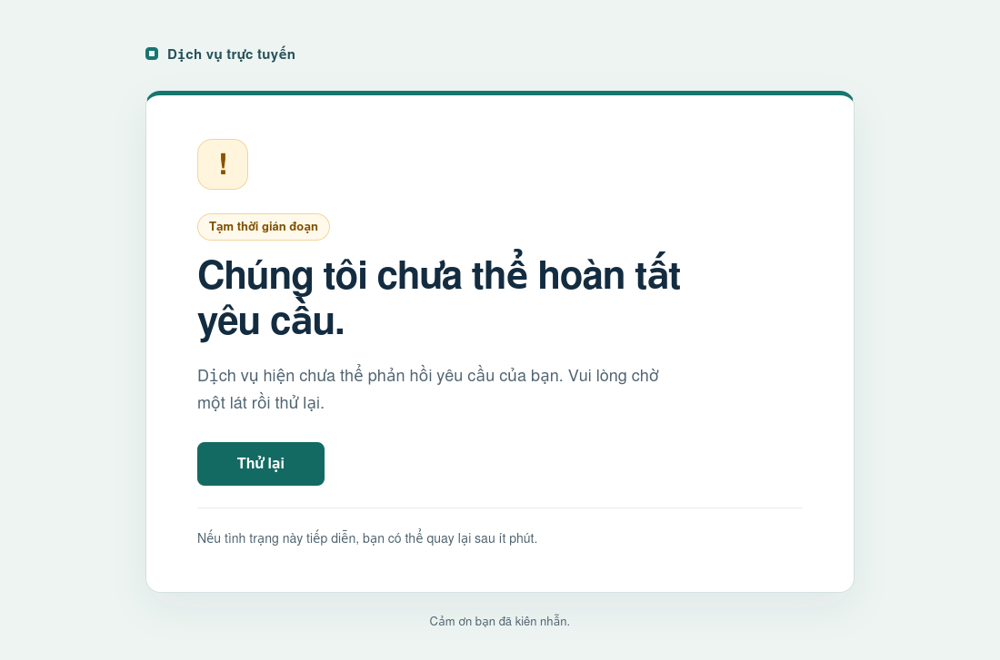

# Báo cáo Lab — Nginx Web Server & Reverse Proxy

> Lab CSC-11117 — Linux OS And Applications
> **Hướng dẫn:** mỗi mục có người phụ trách (xem `tasks.md`). Điền nội dung, dán minh chứng
> (log/ảnh) tương ứng. Giữ `TODO` nếu chưa làm để nhóm biết còn thiếu.

**Nhóm:** _điền tên nhóm_
**Thành viên:** TV1 _..._ · TV2 _..._ · TV3 _..._ · TV4 _..._ · TV5 _..._
**Ngày nộp:** _..._

---

## Phần A — Nội dung lý thuyết

### A.1. Vai trò Web Server & Reverse Proxy; vì sao không để backend nhận request trực tiếp
*(Phụ trách: TV3)*

#### 1. Định nghĩa và Phân biệt
- **Web Server**: Là phần mềm (như Nginx, Apache) chuyên xử lý và phản hồi các yêu cầu qua giao thức HTTP/HTTPS. Vai trò chính là phục vụ tài nguyên tĩnh (HTML, CSS, JavaScript, hình ảnh) với hiệu năng cao, quản lý kết nối TCP/TLS và định tuyến các yêu cầu phức tạp.
- **Reverse Proxy (Proxy nghịch)**: Là máy chủ trung gian đứng trước một hoặc nhiều máy chủ ứng dụng (backend). Thay vì client giao tiếp trực tiếp với backend, mọi request từ client bên ngoài được gửi tới reverse proxy; reverse proxy sẽ kiểm tra, xử lý, rồi chuyển tiếp (forward) request đến backend phù hợp, sau đó nhận kết quả và chuyển ngược về cho client.
- **Phân biệt Forward Proxy (Proxy thuận) vs Reverse Proxy (Proxy nghịch)**:
  - *Forward Proxy*: Đại diện cho **Client** (Client-facing). Nằm giữa client nội bộ và Internet. Client chủ động cấu hình proxy để truy cập ra ngoài (vượt tường lửa, ẩn danh IP client, lọc nội dung web chiều ra). Web server đích chỉ thấy IP của forward proxy mà không thấy client.
  - *Reverse Proxy*: Đại diện cho **Server** (Server-facing). Nằm giữa Internet và hệ thống backend nội bộ. Client hoàn toàn không biết có proxy đứng chặn phía trước và gửi request như tới một server thông thường. Reverse proxy bảo vệ và che giấu toàn bộ hạ tầng backend bên trong.

#### 2. Vì sao không để Backend nhận request trực tiếp từ Internet?
Trong kiến trúc sản xuất hiện đại, ứng dụng backend (Python, Node.js, Java, Go,...) hầu như không bao giờ mở trực tiếp ra Internet vì 5 lý do cốt lõi:
1. **Thu hẹp bề mặt tấn công & Ẩn cấu trúc nội bộ (Attack Surface Reduction)**: 
   Nếu mở trực tiếp, backend application server phải lắng nghe trên card mạng công khai. Kẻ tấn công có thể quét cổng (port scan), tấn công tràn bộ đệm (buffer overflow) vào các framework backend hoặc khai thác lỗ hổng bảo mật trực tiếp. Khi dùng Reverse Proxy, toàn bộ backend chỉ lắng nghe trên mạng nội bộ hoặc card loopback (`127.0.0.1`), không thể bị dò quét hay truy cập trái phép từ bên ngoài.
2. **SSL/TLS Termination tập trung**: 
   Quá trình bắt tay mã hóa TLS (RSA, ECDHE) và giải mã các gói tin HTTPS tiêu tốn năng lực xử lý CPU đáng kể. Nginx được viết bằng C với thuật toán tối ưu cao, đảm nhiệm việc giải mã SSL tại gateway (TLS Termination) và chỉ forward request dạng HTTP plaintext nhẹ nhàng về backend qua loopback, giúp ứng dụng backend giải phóng CPU để tập trung xử lý nghiệp vụ chính.
3. **Cân bằng tải & Mở rộng quy mô (Load Balancing & Scalability)**: 
   Reverse Proxy hoạt động như bộ điều phối lưu lượng, phân phối tải tới nhiều instance backend (Round Robin, Least Connections, IP Hash) để tránh nghẽn cổ chai và hỗ trợ mở rộng quy mô linh hoạt (horizontal scaling) mà phía client không hề hay biết.
4. **Bộ nhớ đệm & Phục vụ file tĩnh (Caching & Static Acceleration)**: 
   Ứng dụng backend thường rất chậm khi phải xử lý I/O đọc/ghi file tĩnh hoặc các truy vấn lặp lại. Nginx có khả năng phục vụ file tĩnh cực nhanh nhờ cơ chế non-blocking event-driven và `sendfile`, đồng thời cache lại các response từ backend để phản hồi ngay lập tức cho client.
5. **Che giấu lỗi hệ thống & Cách ly lỗi (Error Masking & Centralized Logging)**: 
   Khi backend gặp sự cố sập hoặc ném ngoại lệ (unhandled exception), việc trả trực tiếp stack trace ra ngoài có thể để lộ thông tin nhạy cảm (cấu trúc thư mục, phiên bản thư viện, chuỗi kết nối cơ sở dữ liệu). Nginx đứng giữa bắt các lỗi 502/503/504 và trả về trang lỗi tùy chỉnh thân thiện, đồng thời ghi log tập trung phục vụ giám sát và kiểm toán an ninh.

#### 3. Liên hệ thực tế trong Demo 2
- Trong Demo 2 của lab, tên miền `app.local` được Nginx tiếp nhận tại cổng 443 (HTTPS). Nginx thực hiện SSL Termination bằng chứng chỉ tự ký có SAN, sau đó chuyển tiếp request sang backend mock Python qua lệnh `proxy_pass http://127.0.0.1:3000;`.
- Backend Python (`backend/app.py`) chỉ bind duy nhất trên địa chỉ loopback `127.0.0.1:3000`, đảm bảo cách ly tuyệt đối khỏi truy cập trực tiếp.
- Nginx thiết lập các HTTP header bắt buộc (`Host $host;`, `X-Real-IP $remote_addr;`, `X-Forwarded-For $proxy_add_x_forwarded_for;`) để backend nhận diện chính xác danh tính và IP của client ban đầu dù kết nối TCP thực tế tới backend xuất phát từ chính Nginx.


### A.2. Kiến trúc event-driven của Nginx vs process/thread của Apache
*(Phụ trách: TV1)*

- **TODO:** Mô tả mô hình worker + event loop (async, non-blocking) của Nginx.
- **TODO:** Mô tả mô hình process/thread (prefork/worker) của Apache và chi phí context switch, RAM mỗi kết nối.
- **TODO:** Bảng so sánh và hệ quả khi C10K (10.000 kết nối đồng thời) trên VM 512MB.
- **Liên hệ demo:** `worker_connections` trong `nginx/nginx.conf`.

### A.3. Cơ chế Server Block (Virtual Host)

- **Cơ chế chọn Server Block:** Nginx quyết định phân phối request đến Server Block nào bằng cách kiểm tra trước cổng `listen` (IP và Port). Nếu có nhiều block cùng chung IP:Port, Nginx sẽ tiếp tục kiểm tra chỉ thị `server_name` trong file cấu hình xem có khớp với giá trị của trường `Host` nằm trong HTTP Header của request gửi tới hay không.
- **Thứ tự ưu tiên so khớp:** Nginx ưu tiên so khớp theo thứ tự: Tên miền chính xác (exact match) → Tên miền có dấu sao (wildcard) ở đầu → Tên miền có dấu sao (wildcard) ở cuối → Biểu thức chính quy (regular expressions). Nếu không có tên miền nào khớp, Nginx sẽ đẩy request về `default_server` (máy chủ mặc định).
- **Liên hệ demo:** Trong bài thực hành, cả hai tên miền `site1.local` và `site2.local` đều phân giải về cùng một địa chỉ IP nội bộ (`127.0.0.1`) và cùng lắng nghe trên cổng 80. Nhờ cơ chế Virtual Host, Nginx đã đọc được Header `Host` để điều hướng chính xác request lấy nội dung từ các thư mục `root` khác nhau là `/usr/share/nginx/html/site1` và `/usr/share/nginx/html/site2`.

### A.4. access.log / error.log và phân biệt 502, 503, 504
*(Phần Demo 4 theo note nhóm: Tuân)*

`/var/log/nginx/access.log` ghi kết quả từng request. Format `main_ext` trong repo gồm IP client, user, thời điểm, request, status, số byte, Referer, User-Agent, `rt=$request_time` và `urt=$upstream_response_time`. `rt` ghi thời gian xử lý request; `urt` ghi thời gian upstream. Dấu `-` là không có giá trị tương ứng. Format này không chứa Host, nên cần đối chiếu thêm error log và dấu nhận diện request.

`/var/log/nginx/error.log` ghi thời điểm, mức độ, tiến trình và thông báo chẩn đoán; lỗi upstream thường kèm client, server, request, upstream. Cấu hình repo ghi từ mức `warn` trở lên, gồm `error`. Mã HTTP cần được đối chiếu trong access log, còn message trong error log giúp tìm nguyên nhân.

| Mã | Tên | Nguyên nhân thường gặp | Dấu hiệu cần đối chiếu |
|----|-----|------------------------|-----------------------|
| 502 | Bad Gateway | Không kết nối được upstream hoặc upstream phản hồi không hợp lệ | Trong Demo 4: `connect() failed (111: ...)` tới `127.0.0.1:3000` |
| 503 | Service Unavailable | Dịch vụ từ chối phục vụ; trong Demo 3 là vượt rate limit | `limiting requests`, zone `perip` trên `limit.local` |
| 504 | Gateway Timeout | Chờ upstream vượt thời gian cho phép | `upstream timed out` |

Trang lỗi tùy chỉnh thay nội dung phản hồi; mã HTTP 502 vẫn được giữ khi backend dừng. Không suy ra nguyên nhân chỉ từ giao diện trang lỗi hoặc timing. Demo 4 kiểm tra 502; không ghi nhận đã tạo 504 nếu chưa thực hiện kịch bản timeout.

**Minh chứng:** log 503 hiện có ở `docs/logs/rate_limit_503.log`; log 502 thật đã nhận từ VM tại [`docs/logs/backend_down_502.log`](logs/backend_down_502.log). Collector dùng User-Agent `nginx-lab-demo4` cho access 502 và thông tin server/upstream trong error log để giảm lẫn request. VM của Tuân ghi `111: Unknown error`; mã 111 tương ứng `ECONNREFUSED` trong [định nghĩa errno của Linux](https://github.com/torvalds/linux/blob/master/include/uapi/asm-generic/errno.h). Bộ lọc đã được đổi để nhận mã lỗi này, không sửa nội dung log thành `Connection refused`.

---

## Phần B — Kết quả demo

### B.1. Demo 1 — Virtual Host
- **Lệnh:**
  ```bash
  curl -H "Host: site1.local" http://127.0.0.1/
  curl -H "Host: site2.local" http://127.0.0.1/
  ```
- **Kết quả:** 
  - Lệnh 1 trả về: `<h1>Day la Site 1 - Thanh vien 2</h1>`
  - Lệnh 2 trả về: `<h1>Day la Site 2 - Thanh vien 2</h1>`
- **Ảnh:** 
  
  

### B.2. Demo 2 — Reverse Proxy & HTTPS
*(Phụ trách: TV3)*

#### 1. Lệnh kiểm thử & Output thực tế

**Lệnh 1: Kiểm tra HTTP (cổng 80) chuyển hướng 301 sang HTTPS**
```bash
curl -I http://app.local/
```
Output thực tế:
```http
HTTP/1.1 301 Moved Permanently
Server: nginx/1.18.0 (Ubuntu)
Date: Tue, 13 Oct 2026 12:32:27 GMT
Content-Type: text/html
Content-Length: 178
Connection: keep-alive
Location: https://app.local/
```
*Nhận xét:* Nginx phản hồi đúng mã trạng thái `301 Moved Permanently` và chuyển hướng thông qua header `Location: https://app.local/`.

**Lệnh 2: Kiểm tra HTTPS (cổng 443) proxy tới backend Python và bảo toàn header**
```bash
curl -k https://app.local/
```
Output thực tế:
```
Hello from backend (Python)
path: /
Host: app.local
X-Real-IP: 127.0.0.1
X-Forwarded-For: 127.0.0.1
```
*Nhận xét:* Nginx thực hiện SSL Termination thành công và chuyển tiếp request tới backend Python tại `127.0.0.1:3000`. Backend nhận đầy đủ các thông tin: `Host: app.local`, `X-Real-IP: 127.0.0.1`, `X-Forwarded-For: 127.0.0.1`.

**Lệnh 3: Kiểm tra cấu hình SAN (Subject Alternative Name) của chứng chỉ SSL**
```bash
openssl s_client -connect app.local:443 -servername app.local < /dev/null 2>/dev/null | openssl x509 -noout -text | grep -A 1 "Subject Alternative Name"
```
Output thực tế:
```
            X509v3 Subject Alternative Name: 
                DNS:app.local, DNS:localhost, IP Address:127.0.0.1
```
*Nhận xét:* Chứng chỉ self-signed chứa đầy đủ SAN bao gồm `DNS:app.local`, `DNS:localhost` và `IP Address:127.0.0.1` đúng theo tiêu chuẩn của các trình duyệt hiện đại.

#### 2. Kết quả script kiểm thử tự động (`tests/test_https_proxy.sh`)
```
[INFO] Bắt đầu kiểm thử Demo 2: Reverse Proxy & HTTPS (app.local)...
[INFO] Test 1: Kiểm tra HTTP (port 80) chuyển hướng 301...
[PASS] HTTP port 80 trả về status code 301 Moved Permanently.
[INFO] Test 2: Kiểm tra header Location trong phản hồi HTTP 301...
[PASS] Header Location chuyển hướng chính xác: Location: https://app.local/test-path?param=1
[INFO] Test 3: Kiểm tra HTTPS (port 443) phản hồi 200 qua Reverse Proxy...
[PASS] HTTPS port 443 trả về status code 200 OK.
[INFO] Test 4: Kiểm tra nội dung phản hồi từ backend mock...
[PASS] Nhận đúng chuỗi nhận diện từ Python backend.
[INFO] Test 5: Kiểm tra các header X-Forwarded-For, Host, X-Real-IP...
[PASS] Backend nhận đúng header: Host: app.local
[PASS] Backend nhận đúng header: X-Forwarded-For
[PASS] Backend nhận đúng header: X-Real-IP
------------------------------------------------------------
Kết quả kiểm thử: 7 PASS, 0 FAIL
------------------------------------------------------------
```

#### 3. Ảnh minh chứng trên trình duyệt
Ảnh chụp màn hình truy cập HTTPS qua headless browser (`wkhtmltoimage`) lưu tại: [`docs/screenshots/demo2_https.png`](screenshots/demo2_https.png).


### B.3. Demo 3 — Rate Limiting & Benchmark
*(Phụ trách: TV4)*

- **Cấu hình** (`nginx/conf.d/03_rate_limit.conf`): vhost `limit.local` (HTTP:80), giới hạn theo IP client với `rate=10r/s`, `burst=20`, `nodelay`.
  ```nginx
  limit_req_zone $binary_remote_addr zone=perip:10m rate=10r/s;
  limit_req zone=perip burst=20 nodelay;
  ```

- **Lệnh:** `sudo bash scripts/03_run_benchmark.sh` (chạy `ab -n 100 -c 100 http://limit.local/`).  
- **Kết quả `ab`:** `Complete requests: 100`, `Non-2xx responses: 79`, `Requests per second: 7633.01`.  
- **Thống kê:** 200 = **21**, 503 = **79**. Request đầu tiên đi qua cộng 20 request trong `burst` được xử lý ngay nhờ `nodelay` (1 + 20 = 21); phần còn lại vượt burst nên bị trả 503.  
  > `Failed requests: 79` của `ab` chỉ là do body trang 503 ngắn hơn trang 200 (lệch `Length`), không phải lỗi kết nối.
- **Log** (`docs/logs/rate_limit_503.log`):
  ```
  error.log:  [error] ... limiting requests, excess: 20.880 by zone "perip", client: 127.0.0.1, server: limit.local ...
  access.log: 127.0.0.1 - - [15/Oct/2026:08:05:46 +0000] "GET / HTTP/1.0" 503 206 "-" "ApacheBench/2.3" rt=0.000 urt=-
  ```

- **Ảnh:**  
    
  *Kết quả `scripts/03_run_benchmark.sh`: 100 request đồng thời tới `limit.local`, 21 thành công (200) và 79 bị rate limit chặn (503).*


### B.4. Demo 4 — Troubleshooting backend down
*(Phụ trách: Tuân; sử dụng backend/proxy Demo 2 của Tài)*

- **Chuẩn bị:** deploy HTML mới, `sudo nginx -t`, cổng 3000 trống để test tự quản lý backend.
- **Lệnh:** `bash tests/test_troubleshooting.sh --pause`.
- **Kịch bản đã kiểm chứng chức năng:** backend chạy trả 200 → dừng backend trả 502 và đúng HTML tùy chỉnh → khởi động lại trả 200. Truy cập trực tiếp `/50x.html` trả 404 vì `internal`.
- **Lấy log lúc test đang tạm dừng:** `sudo bash scripts/04_collect_logs.sh --demo 4`.
- **Log đã nhận:** [`docs/logs/backend_down_502.log`](logs/backend_down_502.log), có 2 access 502 của User-Agent `nginx-lab-demo4` và 3 lỗi kết nối upstream; thời điểm collector thu thập `2026-10-19T12:34:51Z`. Giữ nguyên các dòng nguồn và mô tả `Unknown error`.
- **Ảnh đã nhận và xem:** [`docs/screenshots/demo4_error_page.png`](screenshots/demo4_error_page.png), chụp qua HTTPS bằng `wkhtmltoimage` trong VM. Ảnh hiển thị đúng trang lỗi tùy chỉnh. Lệnh chụp báo exit 1 khi gặp HTTP 502 nhưng vẫn render file; đã kiểm tra nội dung ảnh thay vì chỉ dựa vào exit code.
- **Kết quả thực tế do Tuân cung cấp ngày 19/10/2026:** deploy đã báo `syntax is ok`, `test is successful`; SAN có `app.local`, `localhost`, `127.0.0.1`. Test đã qua các bước trong bảng dưới và collector đã tạo file log thật.

  | Bước | Kết quả thực tế |
  |------|-----------------|
  | Backend hoạt động | `[PASS] HTTPS trả 200 và đúng nội dung backend.` |
  | Truy cập `/50x.html` trực tiếp | `[PASS] Không thể truy cập trực tiếp /50x.html (404).` |
  | Backend dừng | `[PASS] Backend dừng: HTTPS trả 502 và đúng trang lỗi tùy chỉnh.` |
  | Backend khôi phục | `[PASS] Sau phục hồi, HTTPS trả lại 200 và đúng nội dung backend.` |
  | Kết thúc test | Backend do script tạo đã dừng, trả cổng 3000 về trạng thái ban đầu theo output test |

- **Môi trường nhóm:** VirtualBox của Tuân cấp **4096 MB (4 GB) RAM**, đúng quy định nhóm được Tuân xác nhận ngày 19/10/2026 và ghi tại [`interfaces.md`, mục 0](interfaces.md#0-môi-trường-vm-theo-thống-nhất-nhóm). Đề gốc ghi 512 MB; nhóm dùng 4 GB cho demo, nên bộ kết quả hiện tại đáp ứng cấu hình đã thống nhất và không cần chạy lại ở 512 MB. Nhánh bàn giao Demo 4: `feat/tuan-troubleshooting`; review và merge theo quy trình nhóm.
- **Dòng error log thật từ VM** (giữ nguyên timestamp theo máy chạy và chuỗi `Unknown error`):
  ```text
  2026/10/19 11:19:11 [error] 3574#3574: *8 connect() failed (111: Unknown error) while connecting to upstream, client: 127.0.0.1, server: app.local, request: "GET / HTTP/1.1", upstream: "http://127.0.0.1:3000/", host: "app.local"
  ```
- **Hướng dẫn chạy/chụp:** [`stages/stage-4-troubleshooting.md`](stages/stage-4-troubleshooting.md).



---

## Phần C — Kết luận

- **Lựa chọn triển khai Demo 4:** giữ nguyên backend Python và cấu hình proxy đã chốt; trang lỗi dùng HTML/CSS tự chứa. Test chỉ dừng tiến trình backend do nó tạo, có chế độ chờ lấy ảnh/log và dọn tiến trình khi kết thúc. Collector mặc định chỉ thu Demo 4, giữ minh chứng cũ khi không đủ log phù hợp.
- **Quyết định hạ tầng ngày 19/10/2026:** Tuân xác nhận nhóm sử dụng **1 VM Ubuntu 22.04, RAM 4096 MB (4 GB)**. Áp dụng cấu hình này cho Demo 4 và giữ nguyên bộ kết quả đã thu; không giảm RAM về 512 MB của đề gốc.
- **TODO:** Tổng kết đã làm được gì, hạn chế, hướng phát triển (load balancing, real cert Let's Encrypt, HTTP/2, caching).
- **TODO:** Phân chia đóng góp (ai làm phần nào).

## Phụ lục

- Danh sách file: `docs/files.md`
- Giao diện chung: `docs/interfaces.md`
- Checklist minh chứng: `docs/deliverables.md` (mục 7)
